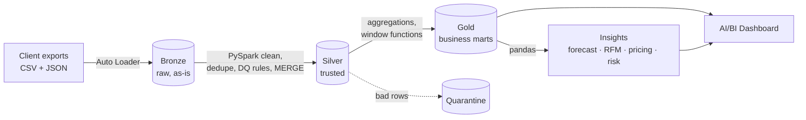

# TradeBooks Lakehouse 🔧📊
**An end-to-end Databricks lakehouse that turns messy bookkeeping exports from trade contractors (plumbers, electricians, HVAC, roofers, carpenters) into profitability, cash-flow and collections insights.**

Built on Databricks (Unity Catalog, Delta Lake, Auto Loader, Lakeflow Jobs, AI/BI Dashboards) with **PySpark** for data engineering and **pandas** for analytics.

---

## The business problem
Small trade contractors run on QuickBooks exports, spreadsheets and paper timesheets. They know their revenue — but not **which jobs actually make money, who owes them, or what next month looks like**. TradeBooks is the data platform behind a bookkeeping + analytics service for these contractors.

## Architecture (Medallion)



| Layer | Tables | What happens |
|---|---|---|
| Landing | Volume `landing/` | 7 entities as monthly CSV/JSON drops (~45K rows, 21 months) |
| Bronze | `bronze_*` | Incremental ingest with Auto Loader, schema rescue, lineage columns |
| Silver | `silver_*`, `silver_quarantine`, `dq_run_log` | Type casting, mixed-format dates, `$1,234` strings, sign errors, dedupe, DQ rules, Delta `MERGE` |
| Gold | `gold_job_profitability`, `gold_monthly_pnl`, `gold_ar_aging`, `gold_cash_flow`, `gold_tech_utilization`, `gold_lead_source`, `gold_client_kpis` | Business-ready marts |
| Insights | `insight_*` | Forecasting, segmentation, pricing, collections risk |

## Results (synthetic data, as of 2026-09-30)
| Metric | Value |
|---|---|
| Combined TTM revenue (5 contractors) | **$17.3M** at **22.0%** net margin |
| Job types below 40% margin target | **12 of 15** |
| Biggest pricing opportunity | Roofing full replacements — **~29.8%** price increase → **~$1.78M/yr** uplift |
| Open A/R | **$1.85M**, of which **$0.96M** is 60+ days late |
| Customers flagged for priority collections | **109** |
| "Champions" segment | **28%** of customers → **50%** of revenue |
| 3-month revenue forecast backtest error (MAPE) | **13.3%** |

## Skills demonstrated
**Data engineering (PySpark):** Auto Loader incremental ingestion · Unity Catalog + Volumes · Delta Lake `MERGE` upserts · idempotent re-runs · window-function dedupe · data-quality rules + quarantine · DQ run log · partitioning · multi-task Lakeflow Job orchestration · Databricks Asset Bundle (IaC)

**Data analytics (pandas):** P&L and unit economics · A/R aging + DSO · seasonality indexing · trend × seasonal forecasting with backtesting · RFM segmentation · pricing elasticity math · risk scoring · matplotlib visualization · SQL dashboards

## Repo layout
```
notebooks/
  00_setup.py               schema + volumes
  01_generate_data.py       synthetic messy source data (pandas)
  02_bronze_ingest.py       Auto Loader → Bronze (PySpark)
  03_silver_transform.py    cleaning, DQ, MERGE → Silver (PySpark)
  04_gold_marts.py          business marts → Gold (PySpark)
  05_analytics_insights.py  forecasting, RFM, pricing, risk (pandas)
sql/dashboard_queries.sql   10 datasets for the AI/BI dashboard
databricks.yml              Lakeflow Job as code (Asset Bundle)
WALKTHROUGH.md              step-by-step build guide
```

## Run it
Runs on **Databricks Free Edition** (serverless). See [`WALKTHROUGH.md`](WALKTHROUGH.md), or quick version:
1. Workspace → **Create → Git folder** → paste this repo URL
2. Run notebooks `00` → `05` in order (defaults: catalog `workspace`, schema `tradebooks`)
3. Build the dashboard from `sql/dashboard_queries.sql`

*All data is synthetic. No real client or employer data is used.*
